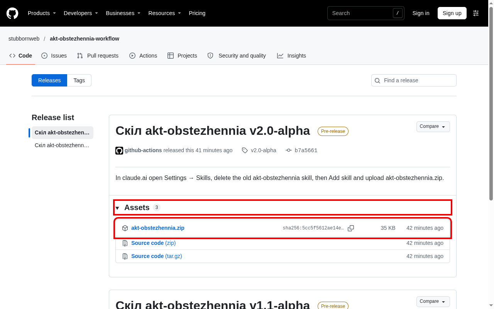
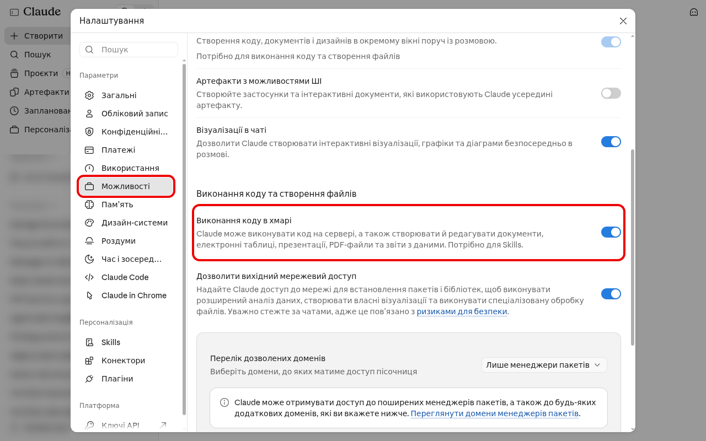
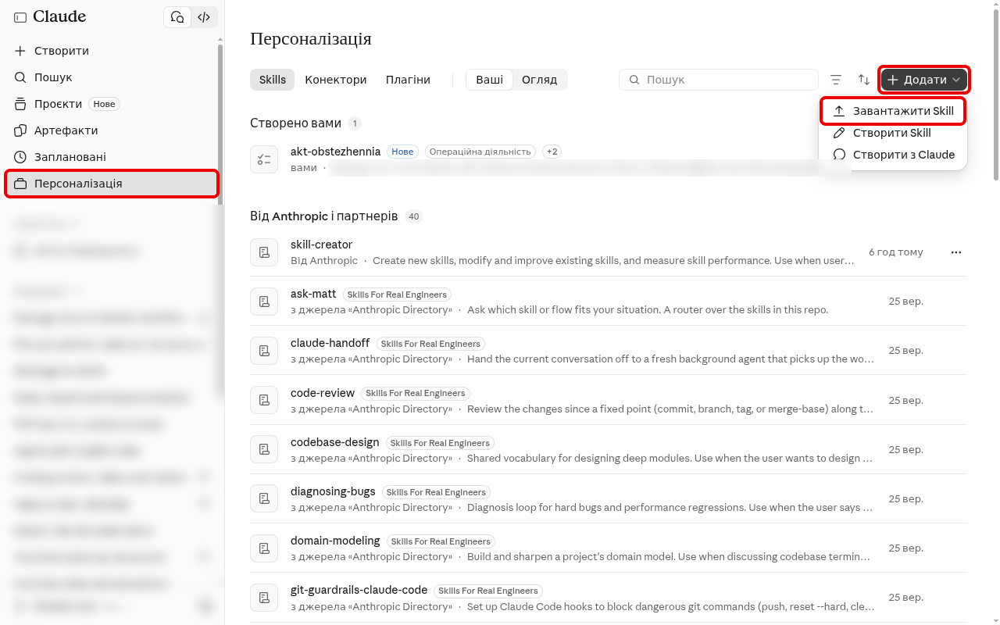
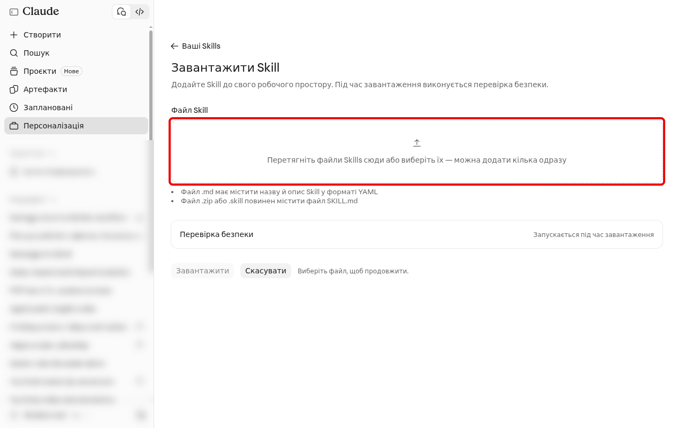
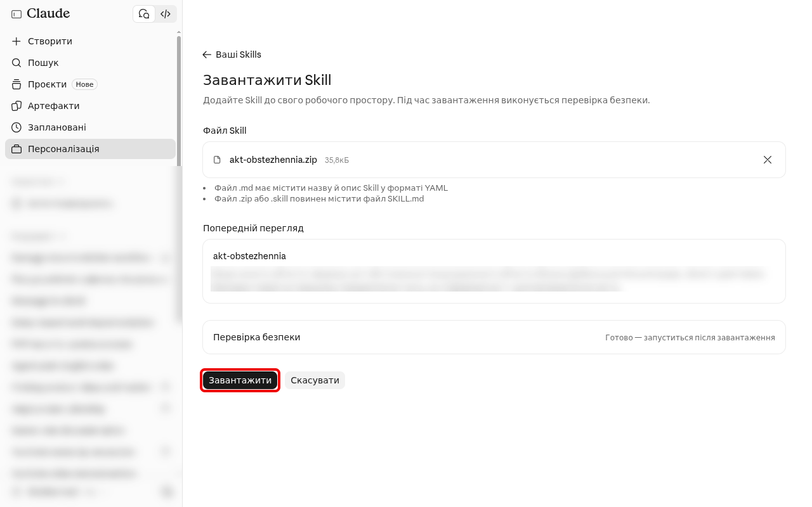
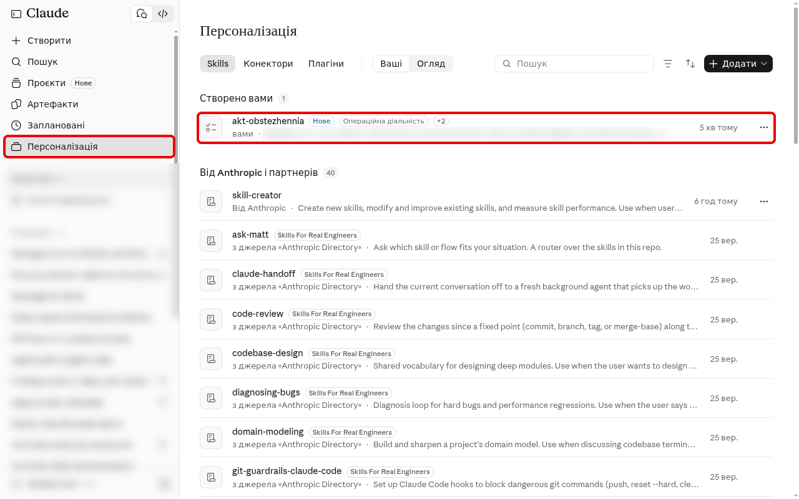
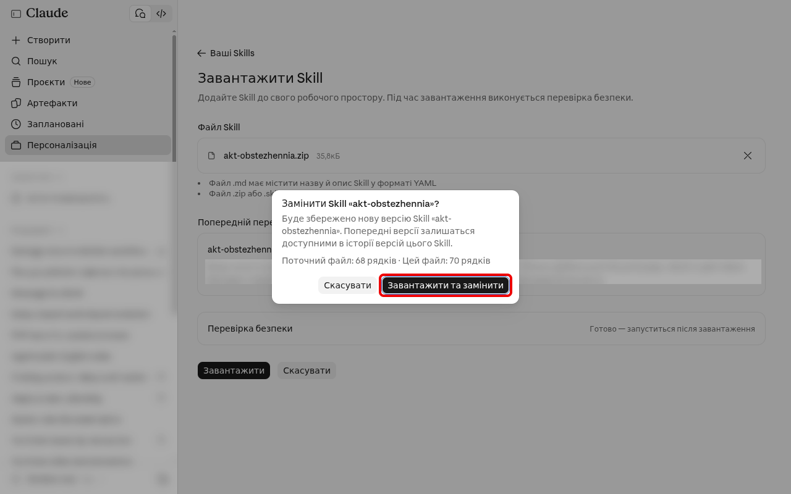
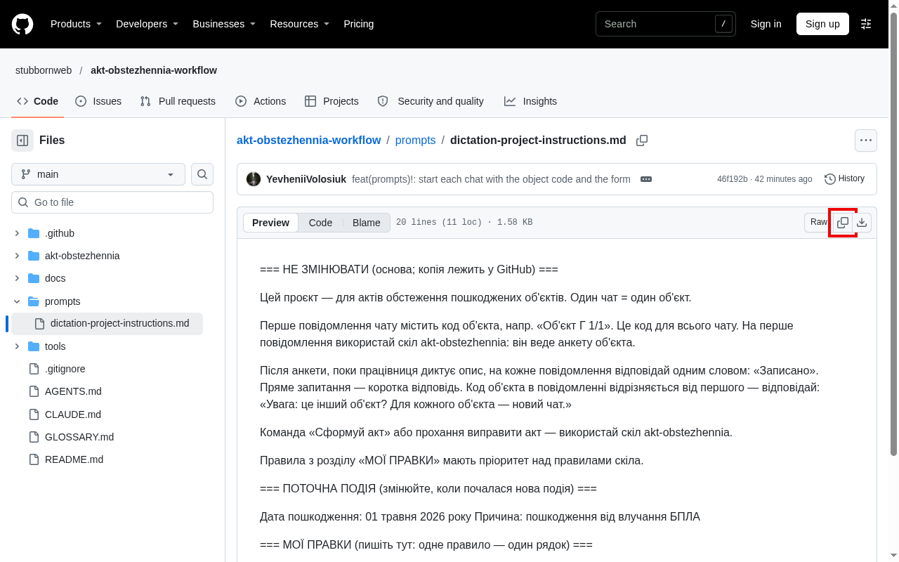

# Посібник: акт обстеження з диктовки

Скіл — це файл з правилами, за якими Claude складає акт. Без нього команда «Сформуй акт» не спрацює.

Частини 1–3 ви робите на комп'ютері, на сайті claude.ai. Частини 4–5 — щодня, у чаті.

1. [Встановити скіл](#1-встановити-скіл) — один раз
2. [Оновити скіл](#2-оновити-скіл) — коли я напишу, що є нова версія
3. [Змінити інструкції проєкту](#3-змінити-інструкції-проєкту) — нова подія, нове правило або новий текст інструкцій
4. [На об'єкті](#4-на-обєкті) — телефон
5. [В офісі](#5-в-офісі) — сформувати акт

## 1. Встановити скіл

1. Відкрийте https://github.com/stubbornweb/akt-obstezhennia-workflow/releases. Найновіший випуск — зверху. Натисніть на слово **Assets**, щоб відкрити список файлів. Потім натисніть **akt-obstezhennia.zip** (не «Source code»). Файл завантажиться на комп'ютер.

   

2. Відкрийте claude.ai. Натисніть своє ім'я внизу ліворуч → **Налаштування** → **Можливості**. Перемикач **Виконання коду в хмарі** має бути увімкнений (синій).

   

3. Закрийте налаштування. Ліворуч натисніть **Персоналізація**. Праворуч угорі натисніть **Додати** → **Завантажити Skill**.

   

4. Натисніть на поле з рамкою. Виберіть файл akt-obstezhennia.zip з папки «Завантаження».

   

5. Натисніть **Завантажити**.

   

6. Скіл akt-obstezhennia з'явиться у списку «Створено вами».

   

7. Перевірте: у новому чаті проєкту «Акти пошкоджень» напишіть «яка версія скіла akt-obstezhennia?». Claude відповість рядком «Версія …».

Скіл встановлюється для всього акаунта. На телефоні нічого робити не треба.

## 2. Оновити скіл

Старий скіл видаляти не треба.

1. Зробіть кроки 1, 3, 4 і 5 з частини 1.
2. Claude запитає «Замінити Skill «akt-obstezhennia»?». Натисніть **Завантажити та замінити**.

   

3. Зробіть крок 7 з частини 1: Claude має назвати нову версію.

Якщо в повідомленні я написав «оновіть інструкції проєкту» — зробіть ще частину 3, розділ «Новий текст інструкцій».

## 3. Змінити інструкції проєкту

Інструкції — це текст у проєкті «Акти пошкоджень». Відкрийте claude.ai → **Projects** → «Акти пошкоджень». Праворуч, біля **Instructions**, натисніть олівець.

У тексті три розділи:

- «НЕ ЗМІНЮВАТИ» — правила для Claude. Цей розділ не змінюйте.
- «ПОТОЧНА ПОДІЯ» — дата і причина пошкодження.
- «МОЇ ПРАВКИ» — ваші правила.

Після змін натисніть **Save**.

**Нова подія** (інша дата чи причина пошкодження): у розділі «ПОТОЧНА ПОДІЯ» змініть дату і причину.

**Нове правило** (напр., від перевіряючого): у розділі «МОЇ ПРАВКИ» допишіть рядок. Одне правило — один рядок.

**Новий текст інструкцій** (коли я напишу «оновіть інструкції проєкту»):

1. Якщо в розділі «МОЇ ПРАВКИ» є ваші рядки — скопіюйте їх у «Нотатки».
2. Відкрийте https://github.com/stubbornweb/akt-obstezhennia-workflow/blob/main/prompts/dictation-project-instructions.md. Праворуч над текстом, поруч зі словом **Raw**, натисніть кнопку з двома квадратиками (**Copy raw file**).

   

3. В інструкціях проєкту виділіть увесь старий текст (**Ctrl+A**) і вставте новий (**Ctrl+V**).
4. Перевірте дату і причину в розділі «ПОТОЧНА ПОДІЯ».
5. Поверніть свої рядки з «Нотаток» у розділ «МОЇ ПРАВКИ».
6. Натисніть **Save**.

## 4. На об'єкті

1. Відкрийте Claude → проєкт **«Акти пошкоджень»** → новий чат. Один об'єкт — один чат.
2. Перше повідомлення — тільки **«Об'єкт Г 1/1»**: ваш код об'єкта. Це коротка назва, зрозуміла вам, без повної назви вулиці.
   Чат має називатися так само: «Об'єкт Г 1/1». Claude сам назву не змінює. Якщо назва інша — натисніть на назву чату (або три крапки біля нього) → «Перейменувати».
3. Claude поставить питання анкети: 6 коротких груп — акт, будівля, конструкції, вікна й опорядження, інженерні системи, пошкодження. Відповідайте голосом або натискайте варіанти. Чого на об'єкті немає — «Немає». Чого не знаєте зараз — «Пропустити».
4. Після анкети натисніть мікрофон і опишіть кожне приміщення — як саме, дивіться нижче в розділі «Як описати приміщення».
5. Перед відправкою гляньте на цифри в тексті.
6. Claude відповідає «Записано» — так і має бути.

Імена, адресу і номери документів **не диктуйте** — їх ви впишете у Word у кінці.

**Немає інтернету:** диктуйте в «Нотатки» телефону, потім скопіюйте текст у чат цього об'єкта.

### Як описати приміщення

Для кожного приміщення скажіть:

1. **Номер з техпаспорта:** «приміщення 3». Однакові пошкодження в кількох приміщеннях — разом: «приміщення 4 і 5».
2. **Що пошкоджено і з чого воно:** «зовнішня цегляна стіна», «стеля з гіпсокартону», «металопластикові вікна».
3. **Наскільки:** «незначне пошкодження», «пошкоджено», «часткове руйнування» або «зруйновано».
4. **Розміри і кількість** вікон і дверей: «вікно приблизно 1,20 на 1,40, дві штуки».
5. **З якого боку**, якщо пошкоджено ззовні: «з боку вулиці», «з боку двору».

Приклад: «Приміщення 3. Зовнішня цегляна стіна зруйнована від підлоги до стелі. На гіпсокартоні тріщини і вибоїни від уламків. Металопластикові вікна зруйновано, приблизно 1,40 на 1,98, дві штуки.»

**Чому так:**

- В акті пошкодження йдуть не по приміщеннях, а по розділах бланка: окремо стіни, окремо підлоги, окремо вікна й двері. Claude сам розкладає вашу розповідь по цих розділах. Тільки номер приміщення показує, де що було. Тому повертаєтесь до приміщення пізніше — назвіть номер ще раз.
- Номер з техпаспорта — бо за ним комісія знаходить приміщення. В акті він стане «Прим.3».
- Слово «пошкоджено» чи «зруйновано» Claude бере тільки від вас. Сам він ступінь не оцінює.
- Розміри і кількість потрапляють в акт так: «орієнт. розміром 1,20×1,40 м (2 шт.)».
- Назву вулиці не кажіть — за нею можна знайти власника.
- Кажіть лише те, що бачите. Акт — офіційний документ, у ньому немає припущень. Фундамент не видно — нічого про нього не кажіть: в акті буде «візуально встановити ступінь пошкодження немає можливості».

## 5. В офісі

1. Відкрийте **той самий чат**.
2. Напишіть: **«Сформуй акт»**.
3. Дайте відповідь на питання Claude (можна «не знаю»).
4. Завантажте файл Word.
5. Впишіть дані в **бірюзові** поля, виправте **червоний** текст, прочитайте висновок.
6. **Не відправляйте**, поки всі пункти зі списку Claude не закриті.

**Виправити акт:** напишіть у тому ж чаті, напр. «у прим.3 три вікна, а не два».

**«Ліміт вичерпано»:** диктуйте далі в «Нотатки», акт сформуєте через кілька годин.
